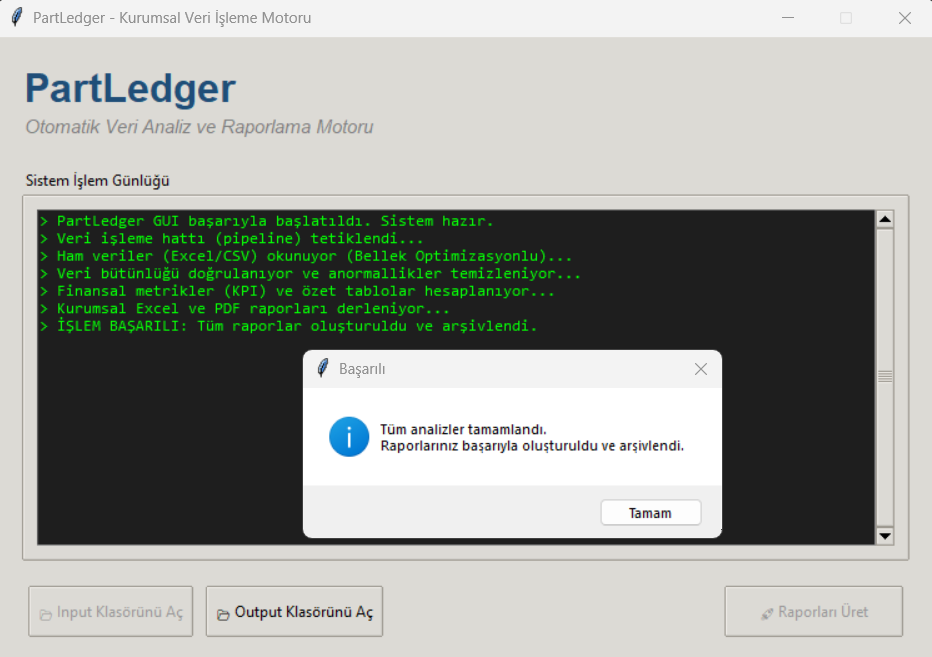
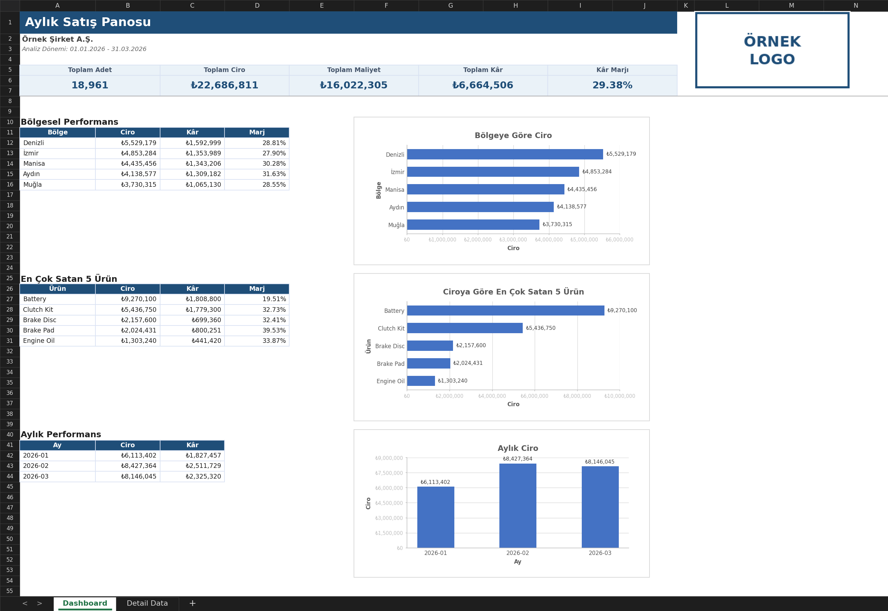
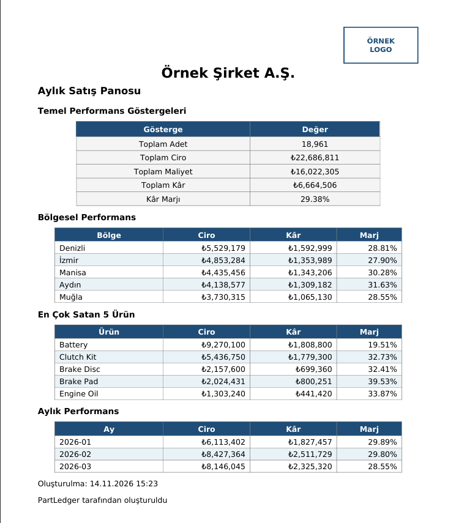
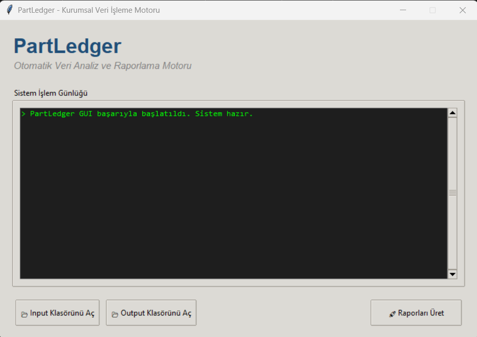
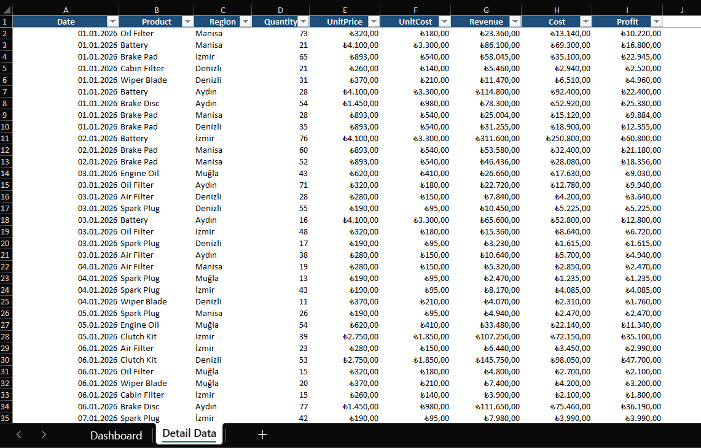
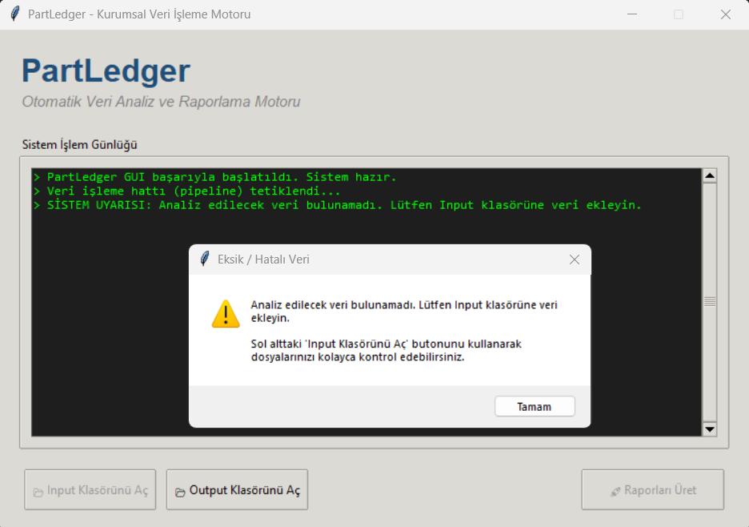
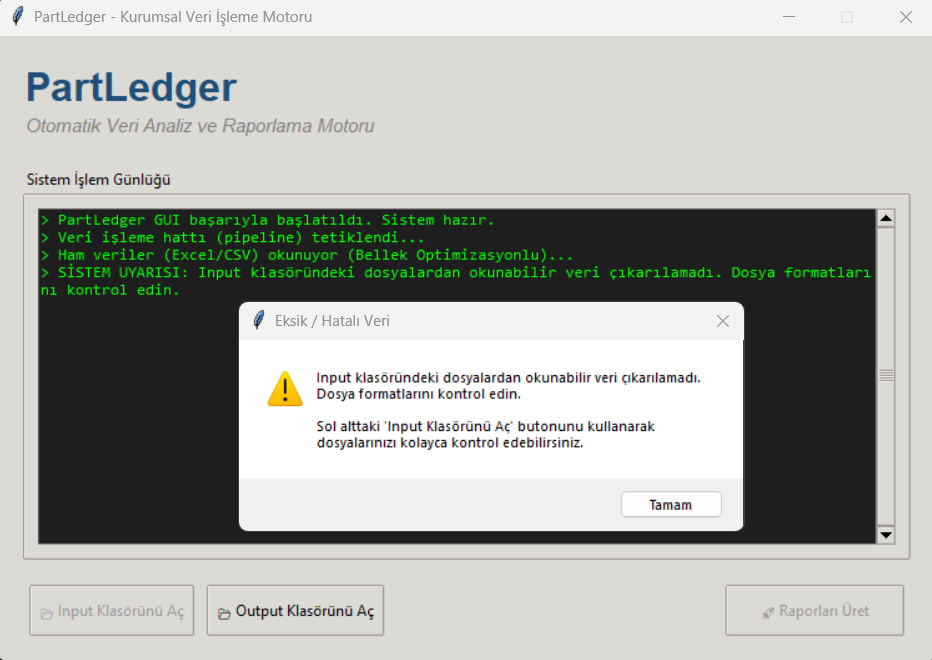

# PartLedger

Excel ve CSV formatındaki satış verilerini otomatik olarak okuyan, doğrulayan,
temizleyen, KPI'ları hesaplayan ve profesyonel bir Excel dashboard ile tek
sayfalık bir PDF yönetici özeti üreten, Windows için paketlenmiş bir masaüstü
raporlama motoru.

> **Not:** Kaynak kod telif hakkı ile korunmaktadır. İzinsiz kopyalanamaz,
> dağıtılamaz veya ticari amaçla kullanılamaz. Bkz. [LICENSE](LICENSE).

---

## Mimari

Proje, katmanlar arası net bir sorumluluk ayrımı (separation of concerns)
üzerine kurulu:

```text
Girdi (Excel/CSV)
      │
      ▼
excel_reader     → dosyaları okur, birleştirir
      │
      ▼
validator        → şema, veri tipi, boş hücre, negatif değer, geçersiz tarih kontrolü
      │
      ▼
data_cleaner     → boş satır, kenar boşluğu ve tekrar eden kayıt temizliği
      │
      ▼
kpi_calculator   → ciro/maliyet/kâr/marj hesaplama, bölge/ürün/aylık özet
      │
      ├──▶ report_generator  → Excel dashboard (KPI kartları, tablolar, grafikler, detay veri)
      └──▶ pdf_report        → tek sayfalık PDF yönetici özeti
      │
      ▼
file_manager     → zaman damgalı arşivleme
```

Arayüz (`main.py`) bu katmanları çağıran ince bir katmandır; iş mantığını
kendi içinde barındırmaz. Ağır işlemler (okuma → hesaplama → rapor üretimi)
arka planda ayrı bir **thread** üzerinde çalışır — arayüz işlem sırasında
donmaz, kullanıcı ilerlemeyi canlı bir log penceresinden takip eder.

## Öne Çıkan Özellikler

- Çoklu Excel/CSV dosyasını (UTF-8 ve Türkçe Windows-1254 / `;` ayraçlı CSV dahil) otomatik okuma ve birleştirme
- Kapsamlı veri doğrulama ve hata koruması: boş klasör, okunamayan/bozuk dosya, eksik kolon, boş hücre, sayısal olmayan değer, geçersiz tarih ve negatif değer kontrolü — hatalı durumda program çökmez, kullanıcıya anlaşılır bir uyarı gösterilir
- KPI hesaplama: toplam adet, toplam ciro, toplam maliyet, toplam kâr ve kâr marjı
- Bölgesel, ürün bazlı (Top 5) ve aylık performans analizi
- Excel Dashboard: KPI kartları, 3 grafik, kurumsal logo, satır bazlı finansal detay sekmesi (`Revenue`, `Cost`, `Profit` dahil) ve tamamen Türkçe arayüz
- Tek sayfalık PDF yönetici özeti (Unicode/Türkçe karakter destekli font ile)
- Multithreading destekli grafik arayüz — canlı işlem günlüğü ve tek tıkla `Input` / `Output` klasör erişim butonları
- Otomatik zaman damgalı arşivleme
- JSON ile yapılandırılabilir kurum bilgisi (isim, başlık, logo, para birimi)
- PyInstaller ile tek dosya Windows EXE paketleme
- **39 otomatik birim testi** — KPI doğruluğu, doğrulama kuralları, uç durumlar (edge cases), Excel/PDF üretimi, dosya yönetimi ve yapılandırma yükleme dahil

## Kullanılan Teknolojiler

Python 3, pandas + openpyxl (veri ve Excel işleme), ReportLab (PDF, Unicode
font desteğiyle), Loguru (loglama), pytest (test), Tkinter (arayüz),
PyInstaller (EXE paketleme).

## 📸 Ekran Görüntüleri

| Canlı Konsol ve İşlem Sonucu | Otomatik Excel Dashboard | Otomatik PDF Yönetici Özeti |
| :---: | :---: | :---: |
|  |  |  |

<details>
<summary><b>Diğer Ekran Görüntüleri (Başlangıç Ekranı, Detail Data Sekmesi ve Hata Yönetimi)</b></summary>
<br>

| Başlangıç Arayüzü | Excel Detail Data Sekmesi |
| :---: | :---: |
|  |  |

| Boş Input Klasörü Uyarısı | Bozuk / Geçersiz Dosya Koruması |
| :---: | :---: |
|  |  |

</details>

## Kurulum

```powershell
git clone https://github.com/aliyagiz207-maker/PartLedger.git
cd PartLedger
python -m venv .venv
.venv\Scripts\activate
pip install -r requirements.txt
```

## Kullanım

Masaüstü uygulamasını başlatmak için:

```powershell
python src/main.py
```

Örnek test verisi üretmek için:

```powershell
python generate_demo_data.py
```

Birim testlerini çalıştırmak için:

```powershell
python -m pytest -v
```

Tek dosya Windows EXE üretmek için:

```powershell
pip install pyinstaller
pyinstaller PartLedger.spec --clean
```

## Yapılandırma

```json
{
    "company_name": "Örnek Şirket A.Ş.",
    "dashboard_title": "Aylık Satış Panosu",
    "currency": "₺",
    "logo_path": "assets/logo_placeholder.png",
    "output_file": "data/output/PartLedger_Rapor.xlsx"
}
```

## Lisans

Bu proje özeldir, tüm hakları saklıdır. Ayrıntılar için [LICENSE](LICENSE).

## Geliştirici

**Ali Yağız Demir** — <https://github.com/aliyagiz207-maker>